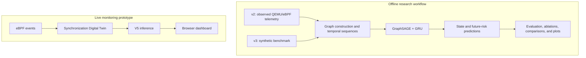

# Deadlock prediction and synchronization graphs

This project investigates temporal deadlock prediction using synchronization graphs and a GraphSAGE-GRU model. It combines an observed QEMU/eBPF data-collection pipeline, a synthetic temporal benchmark for controlled model experiments, and an initial Linux live-monitoring prototype that connects eBPF telemetry to a synchronization Digital Twin and model inference. The repository supports reproducible experiments while keeping synthetic evaluation results separate from evidence obtained from observed or live workloads.

## Project at a glance

- **Collection pipeline:** controlled pthread workloads, Linux eBPF/perf collection, graph construction, and validation.
- **Datasets:** v2 contains observations from QEMU/eBPF workloads. v3 is a larger synthetic dataset for model development.
- **Models:** temporal relational GraphSAGE-GRU models predict Safe, Pre-Deadlock, and Deadlocked states, with optional future-risk outputs.
- **Experiments:** training, evaluation, input ablations, model comparisons, and training-curve plots.
- **Live prototype:** a Linux-only path from eBPF events through a synchronization Digital Twin to V5 inference and a browser dashboard.

## Project overview



This is a conceptual overview, not a verified wiring diagram for every code path. The offline and live workflows use different data-generation and collection paths. The live prototype samples graph snapshots for inference.

## Key results

The committed V5 evaluation and experiment JSON files report the following results on the **synthetic v3 test split**. This split contains 5,549 eight-snapshot sequences. These are benchmark results, not measurements of production or live telemetry.

### V5 state classification — `dataset/v3`, test split

Source: [`outputs/gnn_v5/v5_test_results.json`](outputs/gnn_v5/v5_test_results.json). The saved V5 state thresholds are 0.70 for Deadlocked and 0.56 for Pre-Deadlock.

| Metric | Precision | Recall | F1 | Test examples |
|---|---:|---:|---:|---:|
| Overall accuracy | — | — | 0.7616 | 5,549 |
| Overall macro average | 0.7277 | 0.7386 | 0.7272 | 5,549 |
| Safe | 0.8582 | 0.7720 | 0.8128 | 3,631 |
| Pre-Deadlock | 0.3398 | 0.4983 | 0.4041 | 873 |
| Deadlocked | 0.9850 | 0.9455 | 0.9648 | 1,045 |

### Future-deadlock prediction — `dataset/v3`, test split

These are future-risk-head results on the same synthetic v3 test split. The evaluation uses a 0.5 probability threshold for each risk head.

| Target horizon | Precision | Recall | F1 |
|---|---:|---:|---:|
| Deadlock within 50 ms | 0.9472 | 0.9168 | 0.9317 |
| Deadlock within 100 ms | 0.9433 | 0.8280 | 0.8819 |
| Deadlock within 300 ms | 0.9337 | 0.5753 | 0.7119 |

These are sequence-level future-target metrics. They do not measure event-level warning lead time.

### Ablation findings — `dataset/v3`, test split

The saved ablation summaries are in [`outputs/detailed_ablation/detailed_ablation_results.json`](outputs/detailed_ablation/detailed_ablation_results.json) and [`outputs/graphsagegrucomp_nofuturerisk_study/graphsagegrucomp_nofuturerisk_study_results.json`](outputs/graphsagegrucomp_nofuturerisk_study/graphsagegrucomp_nofuturerisk_study_results.json). All values below are from the synthetic v3 test split.

| Experiment | Result | What it suggests |
|---|---|---|
| History: last 4 snapshots | Macro-F1 0.7272; Pre-Deadlock F1 0.4096 | Better Macro-F1 than the 1-snapshot run in this ablation. |
| History: last 1 snapshot | Macro-F1 0.7139; Pre-Deadlock F1 0.4305 | Higher Pre-Deadlock F1 than the 4-snapshot run, but lower overall Macro-F1. |
| Remove `waits_for` edges | Macro-F1 0.7092 | Performance fell modestly in this run. |
| Remove `owned_by` edges | Macro-F1 0.6693 | Performance fell more than when removing `waits_for`. |
| Remove both edge types | Macro-F1 0.2897; Deadlocked F1 0.0317 | The model performed poorly without graph relations. |
| Zero scheduler features | Macro-F1 0.7281; Pre-Deadlock F1 0.3964 | This variant retained this score after columns 5–8 were zeroed. |
| V5 without risk losses | Macro-F1 0.7310; Pre-Deadlock F1 0.4012 | State metrics were close to full V5 (0.7272 / 0.4041). |

The detailed input ablations use one seed (123) and do not include a newly trained eight-snapshot full-input reference. The risk-loss comparison uses one seed (42). Treat these as exploratory findings, not statistically reliable effects. The no-risk-loss result reports state classification; it does not establish the quality of its untrained risk outputs.

## Repository map

| Path | Contents |
|---|---|
| `src/deadlock_dataset/` | Event, graph, temporal dataset, validation, and CLI code. |
| `collector/` and `workloads/` | eBPF collector and controlled C pthread workloads. |
| `scripts/qemu/` | Create and run the ARM64 Linux guest and workload matrix. |
| `scripts/train_gnn*.py` | Train V3 GraphSAGE-GRU model versions. |
| `scripts/test_gnn*.py` | Evaluate saved model checkpoints. |
| `scripts/ablation_study.ipynb` | Retrain V5 with selected graph inputs or history removed. |
| `scripts/model_comparison.ipynb` | Compare baseline models with the saved V5 model. |
| `scripts/graphsagegrucomp_nofuturerisk_study.py` | Compare a three-class GraphSAGE-GRU baseline and V5 risk-loss variants. |
| `scripts/plot_training_curves.py` | Plot curves from V5 training history. |
| `outputs/` | Saved checkpoints, histories, evaluation results, and experiment tables. |
| `kernel_deadlock_prototype/` | Self-contained prototype for live collection, graph updates, inference, and dashboard. |

Detailed guides for the four main results workflows are in [`scripts/results_readme/`](scripts/results_readme/).

## Datasets

### v2: observed QEMU/eBPF data

[`dataset/v2`](dataset/v2) contains telemetry from controlled pthread workloads running in an ARM64 Ubuntu QEMU guest. It has 720 independent runs, 57,651 snapshots, and 26,486 eight-snapshot sequences. Graphs use 10 ms snapshots and three labels: `safe`, `pre_deadlock`, and `deadlocked`.

The dataset sequence default is 8 snapshots with stride 2, so adjacent sequences can overlap. Some model experiments use different history lengths.

This dataset tests the collection and graph-building pipeline against observed Linux events. See the [v2 dataset guide](dataset/v2/README.md) and [dataset card](DATASET_CARD.md) for the schema, split, validation, and limitations.

### v3: synthetic temporal benchmark

[`dataset/v3`](dataset/v3) contains 2,640 generated runs, 306,709 snapshots, and 62,355 eight-snapshot sequences across 11 scenario families. The validation and test windows do not overlap. It includes future-deadlock targets at 50, 100, and 300 ms.

The stored sequence length is 8 snapshots. Training windows use stride 4; validation and test use stride 8. Ablation experiments may shorten the model input to 4 or 1 snapshot without changing the underlying dataset files.

V3 is generated data, not QEMU/eBPF telemetry. It is useful for model development, but its scores do not establish performance on real programs. See the [v3 dataset guide](dataset/v3/README.md) and [generator notes](dataset/v3/GENERATOR.md).

The Git release stores v3 JSONL data in gzip format. The training code reads the compressed files directly. For other tools that need plain JSONL files, decompress them with `gzip -dk dataset/v3/*.jsonl.gz`.

## Setup

Use Python 3.10 or newer. Keep the research environment separate from the Linux live-monitoring environment.

### Research and model experiments

Create and activate a virtual environment from the repository root:

```bash
python3 -m venv .venv
source .venv/bin/activate
python -m pip install --upgrade pip
```

Install PyTorch for your operating system and hardware using the [official PyTorch selector](https://pytorch.org/get-started/locally/). Choose the CPU build if you do not need GPU acceleration. For an NVIDIA GPU, choose a CUDA build compatible with the installed driver. Install PyTorch before the research packages:

```bash
python -m pip install -r requirements-research.txt
```

The scripts automatically use CUDA when PyTorch reports it is available; otherwise they use CPU. They do not currently select Apple's MPS device automatically, so macOS runs use CPU. The model comparison notebook can also use XGBoost; install it separately with `python -m pip install xgboost` if needed.

The root dataset CLI has no third-party Python runtime dependencies. To install its command entry point, run `python -m pip install -e .`. Dataset generation, validation, and basic data preparation can use the standard library alone.

### Dataset collection

The host-side data tools use the root Python environment. The QEMU collection pipeline also needs QEMU on the host. Its ARM64 Ubuntu guest installs Linux packages for compiling and running the collector. The native eBPF collector needs Linux kernel BTF data, clang, bpftool, libbpf headers, and Linux tracing support. macOS can control the QEMU guest, but cannot run the Linux eBPF collector natively.

### Live-monitoring prototype

Use a separate virtual environment inside `kernel_deadlock_prototype/`. Follow the [live quickstart](kernel_deadlock_prototype/LIVE_QUICKSTART.md) and [Linux VM notes](kernel_deadlock_prototype/docs/linux-vm.md). The quickstart uses `kernel_deadlock_prototype/requirements.txt` and lists the Linux/BCC requirements. Select a compatible PyTorch build for that machine before installing the live requirements. This stack includes `torch-geometric` and is distinct from the root research setup. Live eBPF collection requires Linux and elevated privileges.

### Basic checks

From the repository root, run the unit tests and graph demo:

```bash
make test
make demo
```

Build the C workloads with `make workloads`. These checks do not require QEMU or eBPF. To run the prototype's separate tests, use its environment and run `python -m unittest discover -s tests -v` from `kernel_deadlock_prototype/`.

## Quick start: inspect and train on v3

Audit the committed synthetic dataset:

```bash
python3 scripts/audit_v3_dataset.py --dataset dataset/v3
```

Train V5 using the default settings (seed 42, batch size 32, up to 20 epochs):

```bash
python3 scripts/train_gnn_v5.py --dataset dataset/v3 --output outputs/gnn_v5
```

The model encodes each typed synchronization graph with relational GraphSAGE, processes the snapshot sequence with a GRU, and predicts hierarchical state probabilities. V5 also trains future-risk heads. The best checkpoint is selected with validation data. The test split is reserved for final evaluation.

Evaluate the saved checkpoint:

```bash
python3 scripts/test_gnn_v5.py \
  --dataset dataset/v3 \
  --model outputs/gnn_v5/best_model_v5.pt \
  --output outputs/gnn_v5/v5_test_results.json
```

Training writes the checkpoint and epoch history under `outputs/gnn_v5/`. Evaluation writes classification metrics, class thresholds, and future-risk metrics to JSON.

The V5 checkpoint, training history, test results, detailed-ablation artifacts, and GraphSAGE-GRU comparison artifacts listed above are tracked in this repository. New runs write to the same default folders and can replace them. Use a different `--output` directory to preserve the V5 run. The model-comparison notebook creates its `outputs/v5_analysis/` tables and plots when run; those exports are not included in the current checkout. Results may vary with hardware, software versions, seeds, or notebook settings.

To regenerate the synthetic benchmark, use a different output directory unless you intend to replace the existing files:

```bash
python3 scripts/generate_v3_synthetic.py --output /tmp/deadlock-v3
```

Generation defaults to 240 runs per scenario and seed 20260830. Read [GENERATOR.md](dataset/v3/GENERATOR.md) before changing the dataset configuration.

## Experiments and plots

- **Detailed ablation:** [`scripts/ablation_study.ipynb`](scripts/ablation_study.ipynb) tests shorter histories, removed graph relations, and removed scheduler features. It retrains each selected V5 variant. See the [ablation guide](scripts/results_readme/ablation_study_README.md).
- **Model comparison:** [`scripts/model_comparison.ipynb`](scripts/model_comparison.ipynb) compares classical and neural baselines with the saved V5 checkpoint. See the [model comparison guide](scripts/results_readme/model_comparison_README.md).
- **GraphSAGE-GRU and risk losses:** [`scripts/graphsagegrucomp_nofuturerisk_study.py`](scripts/graphsagegrucomp_nofuturerisk_study.py) compares a standard three-class classifier and full V5 against V5 without auxiliary risk losses. See the [experiment guide](scripts/results_readme/graphsagegrucomp_README.md).
- **Training curves:** [`scripts/plot_training_curves.py`](scripts/plot_training_curves.py) creates PNG and PDF figures from V5 history. See the [plotting guide](scripts/results_readme/plot_training_curves_README.md).

The guides explain how each experiment is run, what it saves, and how to read its metrics. Use validation data for checkpoint or threshold selection. Do not tune on test results. Report per-class metrics alongside Macro-F1, especially for the less frequent Pre-Deadlock class.

## QEMU/eBPF collection pipeline

The collection pipeline uses Linux tracing, so it cannot run end to end on macOS. On Apple Silicon, the repository can create an ARM64 Ubuntu QEMU guest and control it from the host. Install QEMU and provide an Ed25519 public key:

```bash
brew install qemu
scripts/qemu/create_vm.sh ~/.ssh/id_ed25519.pub
scripts/qemu/start_vm.sh
```

After the guest finishes its first-boot setup, SSH is available on port 2222:

```bash
ssh -p 2222 codex@127.0.0.1
```

With the VM running, collect one controlled run:

```bash
python3 scripts/qemu/run_experiment.py abba \
  --mode deadlock --threads 2 --seed 1 --noise cpu
```

Run a configured matrix with:

```bash
python3 scripts/qemu/run_matrix.py \
  --config config/experiments.v2.json --resume
```

Run artifacts include workload ground truth, eBPF events, perf counters, snapshots, and a summary. The workload stream is ground truth; the eBPF stream is observed telemetry. Comparing them helps identify events the collector misses.

The raw event contract is documented in [`docs/event-model.md`](docs/event-model.md). Snapshot and run manifest formats are defined in [`schemas/snapshot.schema.json`](schemas/snapshot.schema.json) and [`schemas/run-manifest.schema.json`](schemas/run-manifest.schema.json).

## Live monitoring prototype

[`kernel_deadlock_prototype/`](kernel_deadlock_prototype/) contains a Linux prototype that connects eBPF events to a synchronization Digital Twin, samples graphs every 10 ms, and sends them to V5 inference. A web frontend displays the graph and predictions.

Start with the [live quickstart](kernel_deadlock_prototype/LIVE_QUICKSTART.md). It requires Linux, BCC/eBPF support, a C compiler, the V5 checkpoint, and the project's Python dependencies. The eBPF collector and full live model integration are not supported on macOS. This is an integration prototype; it does not claim complete kernel coverage or production-level overhead.

## Project limits

- The v2 dataset covers controlled pthread mutex/futex behavior. It does not cover every synchronization primitive or all production workloads.
- V3 is fully synthetic. Results on V3 alone are not evidence of real-world accuracy.
- The live eBPF collector is an initial implementation. See [`README_LIVE_IMPLEMENTATION.md`](kernel_deadlock_prototype/README_LIVE_IMPLEMENTATION.md) for known coverage gaps.
- Keep labels, cycle metadata, identifiers, provenance, and run-level aggregates out of model inputs. Dataset-specific exclusions are listed in each dataset guide.
